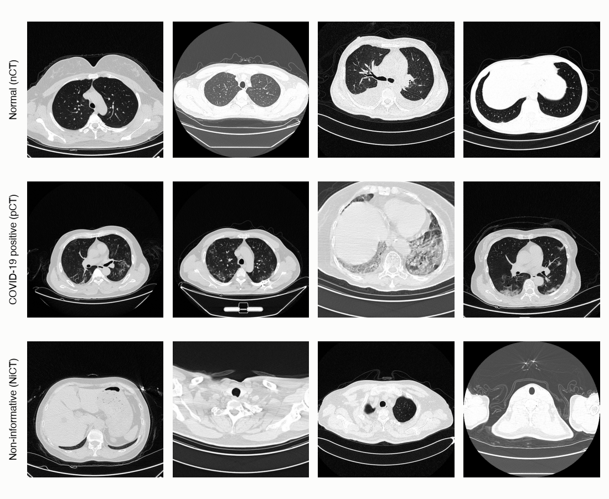
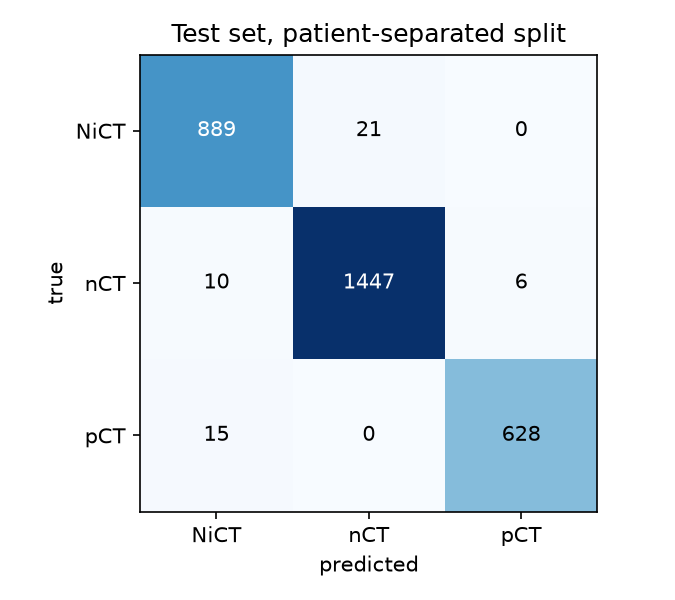
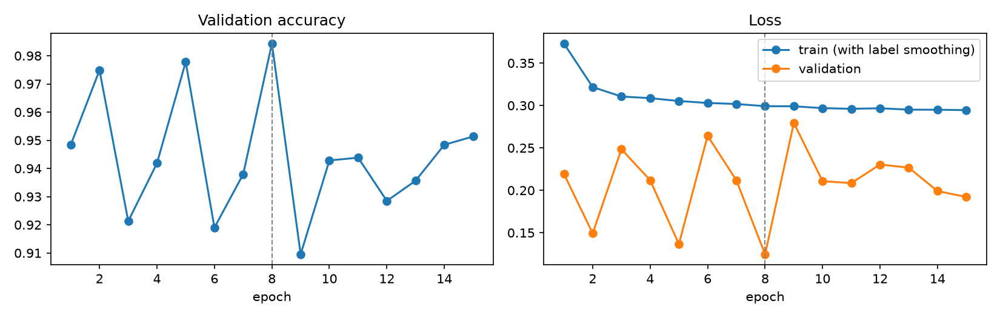
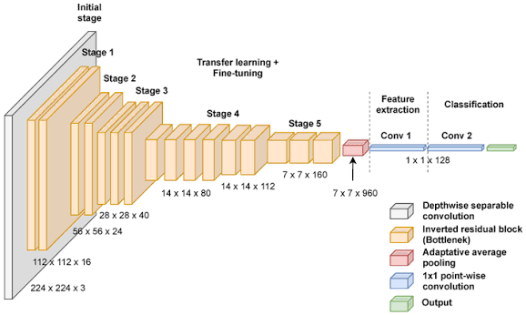

# COVID-19 CT Scan Classifier: patient-separated evaluation

A PyTorch classifier that sorts chest CT slices into three classes: normal, COVID-19 positive and non-informative. It uses transfer learning on MobileNetV3-Large.

This repository builds on [chrispathway/covid-ct-classifier](https://github.com/chrispathway/covid-ct-classifier). The original project reached **99.76% test accuracy**. I found that the original split put slices from the same patients in both training and test. I rebuilt the patient grouping from the images and retrained with a split by patient. With the original training settings, test accuracy on patients the model has never seen was **96.49%**. After changing the training to reduce overfitting, it is **98.28%**.



> This is a learning project. It is not a medical device and must not be used to make decisions about anyone's health.

## Credit: the original project

The original work is by [@chrispathway](https://github.com/chrispathway). Their project includes:

- the classification task and the data pipeline for the Kaggle dataset
- the model: MobileNetV3-Large pretrained on ImageNet, fully fine-tuned, with a new head (960 → 1,280, ReLU, 20% dropout → 3 classes)
- the training setup: AdamW with learning rate 1e-4, batch size 16, 25 epochs
- a port from Windows/CUDA (RTX 2060) to Apple Silicon (PyTorch MPS backend)
- the notebook [classifier.ipynb](classifier.ipynb), the trained weights and the README figures

The original results, with slices split at random (70/15/15 per class, seed 42):

| Split | Images | Accuracy |
|---|---:|---:|
| Train | 13,778 | 98.70% |
| Validation | 2,951 | 99.25% |
| Test | 2,956 | 99.76% |

The original README already named the main weakness in its limitations: *"The split is per slice, not per patient."* My work starts from that point.

## What I changed, and why

### The problem: patients appear in both training and test

The dataset has 19,685 slices, but they come from only about 100 patients. One CT scan is a stack of many slices, and neighbouring slices look almost the same. A random split per slice puts slices of the same patient in both training and test. The model can then recognise a patient it has already seen instead of learning what COVID-19 looks like. Because of this, 99.76% overstates how well the model works on new patients.

The usual fix is to split by patient. In this dataset that is not straightforward, because the filenames (`nCT1.jpg`, `pCT42.jpg`, ...) contain no patient or scan IDs. I could not get the original iCTCF source with patient IDs, so I rebuilt the grouping from the images.

### Step 1: rebuilding the patients from the images (`audit/`)

Five scripts, run in order, recover which slices belong together:

| Step | Script | What it does | Finding |
|---|---|---|---|
| 1 | [step1_inventory.py](audit/step1_inventory.py) | Lists every slice with its size and file hash | 55 exact duplicate pairs (always in the same class). Four image sizes (512, 574, 575, 1211 px) that change only a few times along the file numbering, so the numbering follows scan order |
| 2 | [step2_scan_boundaries.py](audit/step2_scan_boundaries.py) | Compares each slice with the next one by number | Non-512 px images are in scan order with clear breaks between scans. The 512 px block is interleaved: neighbouring numbers are different patients at the same height in the chest |
| 3 | [step3_interleave_period.py](audit/step3_interleave_period.py) | Measures how far apart same-scan slices are in the 512 px block | The interleaving period varies (e.g. 9, 14, 33, ~55), so a fixed step can't undo it |
| 4 | [step4_link_slices.py](audit/step4_link_slices.py) | Links each slice to its most similar successor (threshold 0.90) and follows the chains | 235 / 128 / 36 scan pieces for nCT / NiCT / pCT, with almost no unlinked slices |
| 5 | [step5_patient_groups.py](audit/step5_patient_groups.py) | Joins pieces across classes. A COVID patient's normal-looking slices are in `nCT`, and their slices above and below the lungs are in `NiCT` | 167 patient groups (35 with COVID slices), one `group_id` per slice in `outputs/audit/patient_groups.csv` |

When the threshold is uncertain, the scripts lean toward merging pieces. If two patients end up in one group, they simply stay on the same side of the split, which is harmless. If one patient is split across two groups, slices can leak between training and test.

### Step 2: splitting by patient group ([patient_split.ipynb](patient_split.ipynb))

Groups are split separately for COVID and non-COVID, so both kinds appear in every split. Within each kind, the groups are shuffled with a fixed seed and assigned until each split holds about its share of the slices. A group is never divided, and the notebook checks that no group appears in two splits. The split is saved to `outputs/patient_split/split.csv`.

| Split | Groups | COVID groups | NiCT | nCT | pCT | Total |
|---|---:|---:|---:|---:|---:|---:|
| Train | 130 | 23 | 3,714 | 7,274 | 2,619 | 13,607 |
| Validation | 18 | 7 | 1,081 | 1,242 | 739 | 3,062 |
| Test | 19 | 5 | 910 | 1,463 | 643 | 3,016 |

### Step 3: training on the patient split

I trained twice on this split. Both runs used an NVIDIA GTX 1650 (4 GB).

**Run 1: original settings.** Only the split changed. This shows how much of the original result came from leakage. The log is saved in `outputs/patient_split/run1_baseline.ipynb`.

**Run 2: settings against overfitting.** In Run 1 the training loss fell to about 0.03, but validation loss jumped between 0.08 and 0.63 from one check to the next. The model saved was also the one from the last epoch, not the best one. Run 2 uses the same split with these changes:

| Setting | Original / Run 1 | Run 2 | Why |
|---|---|---|---|
| Epochs | 25 | 15 | Training loss was already flat by about epoch 15 |
| Learning rate | 1e-4, constant | 1e-4, cosine decay to 1e-6 | A constant rate kept the weights jumping between epochs |
| Weight decay | 1e-4 | 0.05 | 1e-4 has almost no effect with AdamW |
| Label smoothing | none | 0.1 | Keeps the model from becoming overconfident on training patients |
| Augmentation | crop 8–100% of the image, flip | crop 60–100%, flip, small rotation, brightness/contrast | Small crops can cut away the lungs |
| Model kept | last epoch | epoch with the lowest validation loss | The last epoch is not necessarily the best one |
| Validation | every 200 steps | once per epoch | The extra passes slowed training without changing it |

Run 1 took 20 hours. Run 2 took 54 minutes, mostly because of fewer epochs and less frequent validation.

### Results

| | Random split (original) | Patient split, Run 1 | Patient split, Run 2 |
|---|---:|---:|---:|
| Validation accuracy | 99.25% | 93.60% | 98.43% |
| **Test accuracy** | **99.76%** | **96.49%** | **98.28%** |
| Test loss | 0.0070 | 0.1253 | 0.1201 |

Per class on the patient-separated test set:

| Class | Run 1 recall | Run 2 recall | Run 2 precision | Slices |
|---|---:|---:|---:|---:|
| `NiCT` | 97.14% | 97.69% | 97.26% | 910 |
| `nCT` | 96.86% | 98.91% | 98.57% | 1,463 |
| `pCT` | 94.71% | **97.67%** | **99.05%** | 643 |



What the numbers show:

- **With the original settings, about 3.3 points of the accuracy came from leakage.** The honest Run 1 result is 96.49%, not 99.76%.
- **The training changes recover about half of the gap.** Run 2 reaches 98.28% on unseen patients.
- **COVID detection improved most.** `pCT` recall went from 94.71% to 97.67%: 15 missed COVID slices instead of 34. All 15 were predicted as `NiCT` and none as normal. Normal slices wrongly flagged as COVID dropped from 32 to 6.
- **The weakest patient is much better.** In Run 1 the worst test groups were at 79%, 89% and 94%. In Run 2 the worst group is at 94.2%, and 14 of the 19 test groups are at 100%.



**A caveat about Run 2.** Validation accuracy still jumps between 91% and 98% from one epoch to the next. The kept model is from epoch 8, the best of those jumps. At the last epoch, validation accuracy was 95.13%. The test set was not used to pick the epoch, so 98.28% is a fair test result. But a run that is this unstable could easily have landed a few points lower, so I would read it as the upper end of what this setup achieves.

### Next steps

- **Stabler training:** find out why validation jumps between epochs (for example the batch norm statistics, or one or two difficult validation patients). Then repeat with several split seeds to report a mean and spread instead of one number.
- **Whole-scan prediction:** combine slice predictions into one prediction per patient (mean or top-k pooling first, then multiple-instance learning on cached features).
- **External evaluation:** test on data from other hospitals ([COVID-CT-MD](https://www.nature.com/articles/s41597-021-00900-3) first, then STOIC for the binary task).
- **Demo:** inference code and a Gradio page where you can upload scans.

## The task

Every image is a single axial slice from a chest CT scan. The model assigns it to one of three classes:

| Class | Meaning | Images |
|---|---|---:|
| `nCT` | Normal. The lungs are visible and show no signs of COVID-19. | 9,979 |
| `pCT` | Positive. The lungs show changes typical of COVID-19 pneumonia. | 4,001 |
| `NiCT` | Non-informative. The slice does not show enough of the lungs to judge. | 5,705 |

The third class matters in practice. A CT scan contains many slices above and below the lungs, and a useful model has to recognise those instead of forcing them into "normal" or "positive".

## Model



The backbone is [MobileNetV3-Large](https://arxiv.org/abs/1905.02244), pretrained on ImageNet. It turns each 224 x 224 image into 960 features. The original 1,000-class head is replaced by one hidden layer of 1,280 units, ReLU, 20% dropout and three outputs. The whole network is fine-tuned, which gives 4.2 million trainable parameters.

## Getting started

### Requirements

- Python 3.11 or newer
- A GPU is recommended. The notebooks use CUDA (my runs were on an NVIDIA GTX 1650 with 4 GB) or Apple Silicon (MPS), and fall back to the CPU otherwise.
- About 4 GB of disk space for the dataset

### Setup

```bash
git clone https://github.com/saharhayek/covid-ct-classifier.git
cd covid-ct-classifier

python -m venv .venv
source .venv/bin/activate        # Windows: .venv\Scripts\activate
pip install -r requirements.txt
```

### Getting the data

The images come from Kaggle. Create an API token under Kaggle > Settings > API > Create New Token, then:

```bash
kaggle datasets download -d azaemon/preprocessed-ct-scans-for-covid19 -p dataset --unzip
```

The download contains original and preprocessed slices. This project uses the original ones:

```
dataset/
└── Original CT Scans/
    ├── nCT/
    ├── NiCT/
    └── pCT/
```

### Running

1. Rebuild the patient groups (writes to `outputs/audit/`):

   ```bash
   python audit/step1_inventory.py
   python audit/step2_scan_boundaries.py
   python audit/step3_interleave_period.py
   python audit/step4_link_slices.py
   python audit/step5_patient_groups.py
   ```

2. Open `patient_split.ipynb` and run all cells. It uses the Run 2 settings and takes about an hour on a GTX 1650. Setting `SMOKE_TEST = True` trains for one epoch, which is useful for checking the setup first.

3. To try the model on your own CT slice, run the *Imports* cell and the last cell of `patient_split.ipynb`. Upload a JPG or PNG with the button. The cell shows the image, the probability for each class and the verdict: COVID-19 signs, no signs, or not enough lung visible. No training is needed, only the saved checkpoint.

The original random-split notebook, `classifier.ipynb`, is still included for comparison.

### Using a trained model

The example loads the original random-split model, which is included in the repository. To use the patient-split model, change the path to `outputs/checkpoints/mobilenet_v3_large_patient_split_run2.pth`, the file `patient_split.ipynb` saves. Both checkpoints use the same architecture.

```python
import torch
from torch import nn
from torchvision import models, transforms
from PIL import Image

ckpt = torch.load("outputs/checkpoints/mobilenet_v3_large.pth", map_location="cpu")

class Head(nn.Module):
    def __init__(self):
        super().__init__()
        self.net = nn.Sequential(nn.Linear(960, 1280), nn.ReLU(), nn.Dropout(0.2), nn.Linear(1280, 3))

    def forward(self, x):
        return self.net(x)

model = models.mobilenet_v3_large(weights=None)
model.classifier = Head()
model.load_state_dict(ckpt["state_dict"])
model.eval()

preprocess = transforms.Compose([
    transforms.Resize(256),
    transforms.CenterCrop(224),
    transforms.ToTensor(),
    transforms.Normalize([0.485, 0.456, 0.406], [0.229, 0.224, 0.225]),
])

image = preprocess(Image.open("path/to/slice.jpg").convert("RGB")).unsqueeze(0)
with torch.no_grad():
    probs = torch.softmax(model(image), dim=1)[0]

for name, idx in ckpt["class_to_idx"].items():
    print(f"{name}: {probs[idx]:.1%}")
```

## Repository structure

```
.
├── audit/                                   Steps 1–5: rebuild scans and patient groups from the images
├── patient_split.ipynb                      Training and evaluation with the patient-separated split (my work)
├── classifier.ipynb                         Original notebook with the random slice split (by @chrispathway)
├── classifier.html                          Static export of the original notebook
├── outputs/checkpoints/
│   └── mobilenet_v3_large.pth               Original trained model (random split)
├── assets/                                  Images used in this README
├── requirements.txt
└── README.md
```

## Limitations

- **The patient groups are reconstructed, not official IDs.** A group can contain two patients, which is harmless for the split. A few patients may still be split across groups, mostly in slices above or below the lungs, so some leakage may remain. The patient-split results are much fairer estimates than 99.76%, but not perfect ones.
- **Small test set in terms of patients.** 19 test groups, only 5 of them with COVID. The result can change noticeably with a different split seed, and so far it comes from a single split and a single run.
- **Limited data sources.** All scans come from two hospitals in Wuhan. Images from other scanners, protocols or populations may look different, and the model has not been tested on them.
- **Single slices only.** The model judges one slice at a time. A clinical assessment considers the full scan together with symptoms and lab results.

## Acknowledgements

- Original project: [chrispathway/covid-ct-classifier](https://github.com/chrispathway/covid-ct-classifier) by [@chrispathway](https://github.com/chrispathway). The model, the training code and the random-split baseline are their work.
- Dataset: [CT Scans for COVID-19 Classification](https://www.kaggle.com/datasets/azaemon/preprocessed-ct-scans-for-covid19) by Abu Zahid Bin Aziz, licensed under CC BY 4.0. The original images are from the [iCTCF](http://ictcf.biocuckoo.cn/) resource: Ning, W. et al., "iCTCF: an integrative resource of chest computed tomography images and clinical features of patients with COVID-19 pneumonia" (2020).
- Model: Howard, A. et al., ["Searching for MobileNetV3"](https://arxiv.org/abs/1905.02244), ICCV 2019. Pretrained weights from [torchvision](https://pytorch.org/vision/stable/models/mobilenetv3.html).
